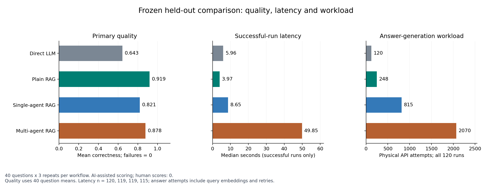

# Multi-Agent Research Assistant

[简体中文](README.zh-CN.md)

A local document research application with a FastAPI API, a same-origin web UI,
and a LangGraph workflow: Planner → Retriever → Researcher → Critic → Writer →
Citation Validator. Upload PDF, Markdown, or UTF-8 TXT files, ask a question,
follow progress, and inspect the sources attached to the report.

This is an independent, non-commercial learning project that selectively adapts
[NirDiamant/GenAI_Agents](https://github.com/NirDiamant/GenAI_Agents) at commit
`4c95ae14cc2462c442b5c064cccd74430d02bc46`. It is not affiliated with or endorsed
by Nir Diamant. The upstream custom [LICENSE](LICENSE) restricts commercial use;
commercial permission must be obtained from the licensor in writing. Attribution,
source cells, and file mappings are in [THIRD_PARTY_NOTICES.md](THIRD_PARTY_NOTICES.md).

## Features and boundaries

- Local parsing, source-preserving chunks, embeddings, cosine search, and reciprocal rank fusion.
- Structured agent outputs, bounded Critic revision, citation ID validation, and explicit evidence insufficiency.
- SQLite documents, vectors, reports, stage checkpoints, and ordered events; incomplete runs are rescheduled on startup.
- Upload/selection UI, report rendering, source excerpts, SSE progress, and polling fallback.
- DashScope and OpenAI compatible providers; deterministic fake chat and embeddings for offline demonstration and CI.
- A synthetic [30-case benchmark](benchmarks/cases.jsonl), four workflow variants, and JSON/CSV/Markdown reports.
- [Per-request usage tracking and evaluation recovery](docs/evaluation/budget-control.md), with [DeepSeek CLI helper tasks](docs/evaluation/deepseek-cli.md).

The application has no internet search, OCR, authentication, multi-tenant access
control, or distributed queue. Citation validation checks source identity and
format; it does not establish that a claim is true. Fake output demonstrates
the software workflow and is not evidence of real-model research quality.

The [real-document evaluation](docs/evaluation/heldout-test/RESULTS.md) retains
480 executions across four workflows. Read the [executed analysis notebook](output/jupyter-notebook/real-evaluation-analysis.ipynb),
[seven failure cases](docs/evaluation/heldout-test/FAILURE-CASES.md) and
[offline reproduction guide](docs/evaluation/heldout-test/REPRODUCE.md).
Plain RAG has the highest observed quality on this small dataset; the report
describes multi-agent tradeoffs and the limits of AI scoring without human validation.

For a short project tour, start with the [English project brief](docs/portfolio/project-brief.md),
[demonstration and screenshots](docs/portfolio/demo-guide.md),
[three-minute walkthrough](docs/portfolio/presentation.zh-CN.md) and
[technical report](docs/technical-report.md).

## Quick start: offline fake providers

Use Python 3.11 (the supported range is 3.11–3.12). Installation needs package
downloads; the fake application and tests make no model-provider calls.
Run commands from the repository root:

```bash
python -m venv .venv
```

Activate with `source .venv/bin/activate` on Linux/macOS, or
`.venv\Scripts\Activate.ps1` in PowerShell, then:

```bash
python -m pip install -r requirements/upstream-requirements.txt
python -m pip install -r requirements/project-requirements.txt
```

Launch a preloaded, isolated offline demo with one command:

```bash
python examples/run_demo.py
```

Open the printed loopback URL and select both documents. This launcher fixes
both providers to fake, ignores local credential/environment configuration and
uses a fresh database under `artifacts/demo/`. `--check` runs the upload, workflow,
SSE, citation and persistence checks and exits. See the [demo guide](docs/portfolio/demo-guide.md).

For a manually configured application session instead, use the commands below.

In Bash:

```bash
CHAT_PROVIDER=fake EMBEDDING_PROVIDER=fake RETRIEVAL_MIN_SIMILARITY=-1 python -m uvicorn app.main:app --host 127.0.0.1 --port 8000
```

In PowerShell:

```powershell
$env:CHAT_PROVIDER = 'fake'
$env:EMBEDDING_PROVIDER = 'fake'
$env:RETRIEVAL_MIN_SIMILARITY = '-1'
python -m uvicorn app.main:app --host 127.0.0.1 --port 8000
```

Open [the local UI](http://127.0.0.1:8000), upload files from
`examples/demo-corpus`, select them, and ask “What are the project's goals and
evaluation limitations?” API documentation is at [local Swagger UI](http://127.0.0.1:8000/docs).
The fake provider synthesizes supplied evidence deterministically; it is not an LLM.
The demo's -1 similarity threshold keeps evidence available with toy hash
embeddings. The real-provider default is 0.15; do not use the demo threshold to
infer retrieval quality.

## DashScope / Qwen setup

Copy `.env.example` to `.env`. Set `CHAT_PROVIDER=dashscope` and
`EMBEDDING_PROVIDER=dashscope`, and put your own DashScope credential in the
blank `DASHSCOPE_API_KEY` field of that local file. Keep the following defaults
unless your account uses different supported models or a regional endpoint:

```dotenv
DASHSCOPE_BASE_URL=https://dashscope.aliyuncs.com/compatible-mode/v1
DASHSCOPE_CHAT_MODEL=qwen3.7-flash
DASHSCOPE_EMBEDDING_MODEL=text-embedding-v4
EMBEDDING_BATCH_SIZE=10
```

The DashScope-compatible defaults keep embedding batches within the current
`text-embedding-v4` limit. Structured JSON requests also disable Qwen thinking
output so workflow stages return bounded machine-readable responses.

Unset earlier shell provider and similarity overrides or use a fresh terminal,
activate the environment, and start the real-provider configuration:

```bash
python -m uvicorn app.main:app --host 127.0.0.1 --port 8000
```

Shell variables override `.env`.
The configured model names do not imply account availability or a successful
live run. Real-provider requests can incur charges and send document text to
the provider. OpenAI can be selected with both provider fields set to `openai`
and a local `OPENAI_API_KEY`; its endpoint/model fields are in `.env.example`.
Use separate database/upload paths when changing embedding models, and ingest
documents again: stored vectors are tied to their embedding model.

## API and SSE examples

These examples use Bash curl syntax; use `curl.exe` with your shell's quoting
rules on Windows. The explicit MIME type is required for upload validation.

```bash
curl -F 'files=@examples/demo-corpus/project-overview.md;type=text/markdown' http://127.0.0.1:8000/api/documents
curl http://127.0.0.1:8000/api/documents
```

Upload returns HTTP 201 with `{"documents":[...]}`. Copy a returned `id` into
`DOCUMENT_ID` below; it is a placeholder, not a fixed demo identifier:

```bash
curl -i -H 'Content-Type: application/json' -d '{"question":"What are the project goals?","document_ids":["DOCUMENT_ID"]}' http://127.0.0.1:8000/api/research
```

HTTP 202 returns `run_id`, `status`, and a `Location` header. Replace `RUN_ID`
below with that value. Run states are `queued`, `running`, `completed`, `failed`.

```bash
curl -N http://127.0.0.1:8000/api/research/RUN_ID/events
curl http://127.0.0.1:8000/api/research/RUN_ID
curl -N -H 'Last-Event-ID: 5' 'http://127.0.0.1:8000/api/research/RUN_ID/events?after=3'
```

The run response contains `run` and `report` (null until available). SSE emits
`event: workflow`, an integer `id`, and JSON with `sequence`, `run_id`, `stage`,
`event_type`, `payload`, and `created_at`. Resume uses the greater of `after`
and `Last-Event-ID`; the example replays events after sequence 5. Keep-alive
comments maintain idle streams; terminal streams close after queued events drain.
Delete a document with `DELETE /api/documents/DOCUMENT_ID`. Health is at `/health`;
provider readiness there is configuration readiness, not a live endpoint probe.

## Tests and experiments

The full test suite also requires Node.js 22 for the browser behavior harness.
The application itself has no Node build step. CI configures both runtimes.

```bash
python -m pytest -m "not live" -q
python scripts/verify_repository.py
python -m app.evaluation.cli --provider fake --variants all --output-dir artifacts/evaluation/fake --enforce-gate
```

The benchmark writes `results.json`, `results.csv`, and `report.md` under the
chosen output directory. The release gate applies to `multi_agent_rag`; the
other three variants are comparisons. Generated results stay untracked and CI
uploads them as artifacts. See [experiments](docs/experiments.md) for exact metric
definitions, thresholds, real-provider commands, and limitations. No real-model
quality or speedup is claimed by the fake benchmark.

A [five-question live development pilot](docs/evaluation/dev-pilot/README.md)
now publishes real Qwen answers, evidence, blinded DeepSeek judgments, explicit
Codex source adjudications, and physical request receipts. The final 20-unit
matrix executes successfully after documented fixes; earlier failures are retained.
These remain AI-reviewed development results, with no human scores; the separate
held-out comparison is reported below. Recheck scores, hashes and costs without API calls:
`python scripts/verify_dev_pilot.py`.

The subsequent [complete development run](docs/evaluation/full-dev/README.md)
covers 20 questions and 80 units: 77 executions succeeded, 3 failed. All successful
answers have AI scores; 21 received explicit Codex source checks. The report
separates execution reliability, conditional answer quality, citation-block
support, latency and physical request usage. It also exposes previously uneven
citation-format validation across workflows. This remains development evidence;
it is kept separate from held-out results. Verify with `python scripts/verify_full_dev.py`.

[Post-development repairs](docs/evaluation/post-dev-repairs.md) add uniform inline
citation validation and request-specific evidence-ID schemas. Separate targeted
confirmations retain v7's 3/4 outcome and v8's successful single-case check; they
do not replace the original run. Full validation with the final rules precedes
experiment freeze and held-out testing.

The separate [final-rule development regression](docs/evaluation/final-dev/README.md)
now completes **80/80 executions**, with **60/60 grounded answers** passing the
shared citation structure checks. All 80 answers have AI scores after 21 source
reviews; original judgments and 12 explicit corrections are retained. Mean
key-point correctness is 0.892 for plain RAG, 0.854 for single-agent RAG and
0.875 for multi-agent RAG; multi-agent median latency is 40.95 seconds. These
reused development questions do not establish an architecture winner.
[Findings and limitations](docs/evaluation/final-dev-observations.zh-CN.md)
separate syntax, semantic support, missing usage and human review (still zero).
The [test preparation](docs/evaluation/test-freeze-preparation.md) records the
comparison and sampling choices made before held-out answers. The committed
experiment identity now binds the runner and its prerequisites.

The [frozen experiment runner](docs/evaluation/frozen-experiment.md) now implements
repeat-specific identities, durable interruption handling, separate index/answer/
judge ledgers and the prespecified paired family analysis. The
[freeze record](benchmarks/real-v1/frozen-experiment.json) binds 257 input files;
development-only test-schema calibration passed 19/20 judgments, retaining the
one format error and all 21 requests. The [held-out results](docs/evaluation/heldout-test/RESULTS.md)
now retain **480/480 executions: 473 successful, 7 failed**, with three fresh serial
repeats of 40 questions and four workflows. The 80 prespecified source reviews
and 17 additional error/failure reviews are complete; raw original judges,
literal proofs and 37 explicit Codex follow-ups remain separate. All 473
successful answers have AI scores; human reference/answer reviews remain **0**.
Plain RAG has the highest observed primary quality (0.919), followed by multi-agent
RAG (0.878), single-agent RAG (0.821) and the closed-book baseline (0.643).
The prespecified multi-agent-minus-single-agent difference is +0.057 on 40 paired
questions, with exploratory eight-family-bootstrap 95% interval [0.014, 0.097].
Multi-agent median successful latency is 49.85 seconds versus 8.65 seconds for
single-agent RAG. These AI-assisted results do not establish general superiority.
[Chinese findings](docs/evaluation/heldout-observations.zh-CN.md) explain this tradeoff.
Recompute public identities, original scores, reviewed scores, receipts and statistics:
`python docs/evaluation/heldout-test/tools/reproduce_frozen.py`.
The [analysis notebook](output/jupyter-notebook/real-evaluation-analysis.ipynb)
executes seven cells from a fresh kernel, rebuilds the tables from saved decisions
and traces, and exports [quality/latency/workload](docs/evaluation/heldout-test/figures/workflow-comparison.svg),
[paired uncertainty](docs/evaluation/heldout-test/figures/paired-quality.svg) and
[citations/failures](docs/evaluation/heldout-test/figures/citations-and-failures.svg).
Follow the [reproduction guide](docs/evaluation/heldout-test/REPRODUCE.md) to regenerate
these figures without model calls. [Seven selected cases](docs/evaluation/heldout-test/FAILURE-CASES.md)
explain unsupported claims, retrieval misses and unresolved execution failures.



The [local supervisor](docs/evaluation/heldout-test/PROCESS.md) retains all three
generation checkpoints and the initial analysis before source review.
Historical analysis uses the original `7e0cf6c` source snapshot in an isolated
worktree, allowing later product fixes to retain reproducible evidence. The
original frozen-run guard remains strict; see the [reproduction guide](docs/evaluation/heldout-test/REPRODUCE.md).

The [post-experiment startup repair](docs/engineering/post-evaluation-maintenance.md)
covers the ordinary configured Uvicorn entry as well as the isolated demo. Run
`python docs/engineering/tools/check_default_startup.py` for its real-process,
fake-provider HTTP acceptance check.

## Privacy and development

Uploads default to `data/uploads`; SQLite defaults to `data/research_assistant.db`.
Documents, extracted text, vectors, questions, state snapshots, and reports stay
on your machine in fake mode. With a real embedding/chat provider, document text,
questions, and evidence are transmitted to the configured provider. Local files
are not encrypted by this application. There is no automatic retention policy;
deleting a document does not promise to erase its text from earlier run reports
or snapshots. Treat all local data and custom evaluation outputs as private.
The synthetic governance corpus is fictional and does not define app retention.

Bind to loopback for personal use. Store credentials only in local environment
configuration, never in Git, screenshots, or evaluation reports. The verifier
checks tracked working-tree files for runtime data, common credential patterns,
licenses, benchmark evidence, and adapted-file attribution; it is not a scan of
Git history or a substitute for reviewing staged changes.

Read [architecture](docs/architecture.md), [technical report](docs/technical-report.md),
and the
[release checklist](docs/release-checklist.md) for developer and release details.
