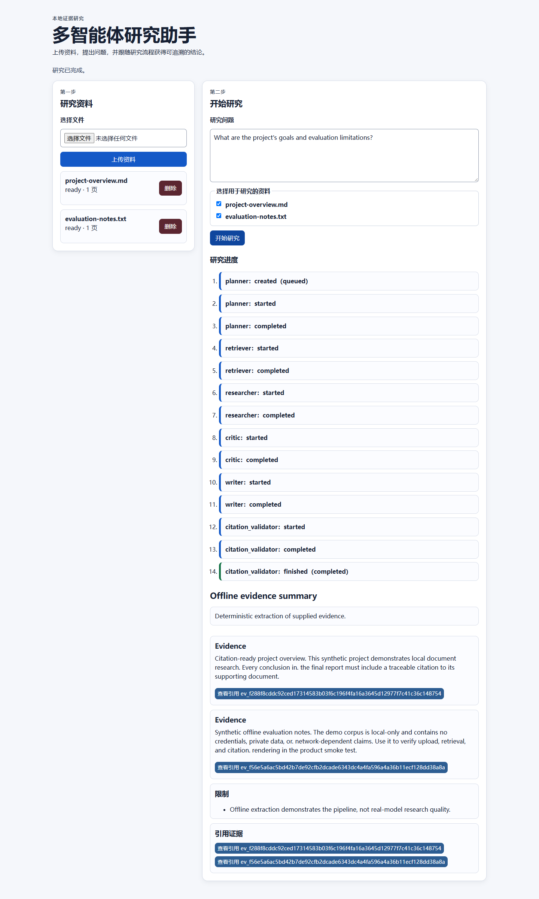
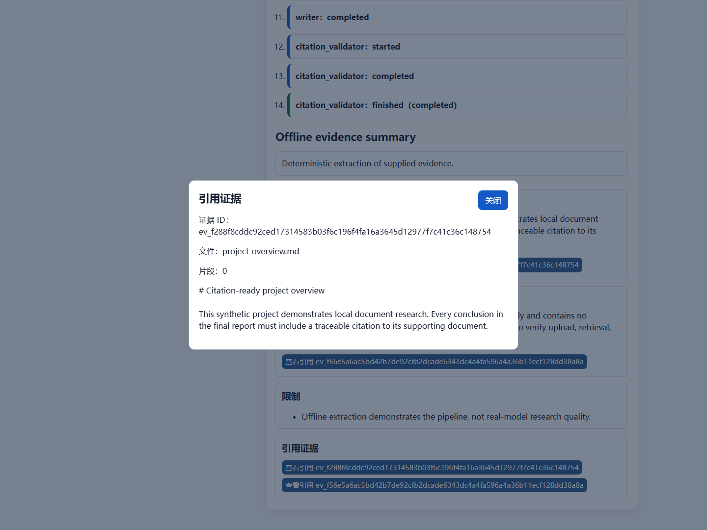

# Reproduce the application demonstration

This demonstration runs the real FastAPI application, storage, workflow and
browser interface with deterministic **fake chat and embeddings**. It makes no
model API calls. Its screenshots demonstrate the software flow; answer-quality
claims belong to the separately saved [real-model study](../evaluation/heldout-test/RESULTS.md).

## Start with one command

After installing the project requirements from the [README](../../README.md),
activate the project environment and run from the repository root:

```bash
python examples/run_demo.py
```

Open the printed loopback URL. Both synthetic demo documents are preloaded.
Select them, enter the suggested question and click **开始研究**. Follow the
stage timeline, read the report and click **查看引用** to inspect the source
filename, chunk location and exact excerpt. Uploading the same demo files again
through the UI is safe: the ingestion service deduplicates their content hashes.

The launcher ignores `.env`, process environment settings and secret files. It
creates a fresh session under `artifacts/demo/<session>/` with its own database
and uploads. It does not share the configured application database. The -1
similarity threshold is intentional for toy hash embeddings and should not be
used to infer real retrieval quality. Stop with Ctrl+C. A new invocation starts
another fresh session; older session files remain local.

If port 8000 is occupied, choose another or let the OS select one:

```bash
python examples/run_demo.py --port 8001
python examples/run_demo.py --port 0
```

## Check the integration without a browser

```bash
python examples/run_demo.py --check
python -m pytest examples/test_demo_runner.py -q
```

The check exercises actual upload, research, SSE and report routes, verifies
citations for both documents, and reopens the saved report through a new
container. Tests also verify that an existing environment and `.env` cannot
redirect the demo to real providers or a working database. It is separate from
the frozen scientific implementation and does not change that experiment's inputs.

## Capture the real browser workflow

Browser capture is optional and has a separate dependency. Install Playwright
1.55.0 into a tooling environment and use an installed Chrome or Edge browser:

```bash
python -m pip install playwright==1.55.0
python docs/portfolio/tools/capture_demo.py --browser chrome
```

If the tooling Python differs from the project's Python, pass
`--app-python /absolute/path/to/project/python`. On Windows this can be
`.venv/Scripts/python.exe`. `--browser msedge` selects Edge;
`--browser chromium` uses a separately installed Playwright Chromium. Browser
installation is an online setup step; fake generation requires no provider access.

The capture helper starts its own server on a free loopback port, drives actual
upload/selection/research/citation interactions, checks all six workflow stages
and reload persistence, then stops the server. It saves two screenshots plus
[verification metadata](demo-verification.json) with observed checks, browser
version, helper-input hashes and screenshot hashes. Local server logs remain in
`artifacts/demo-browser/`.





[Project brief](project-brief.md) · [Three-minute walkthrough](presentation.zh-CN.md)
